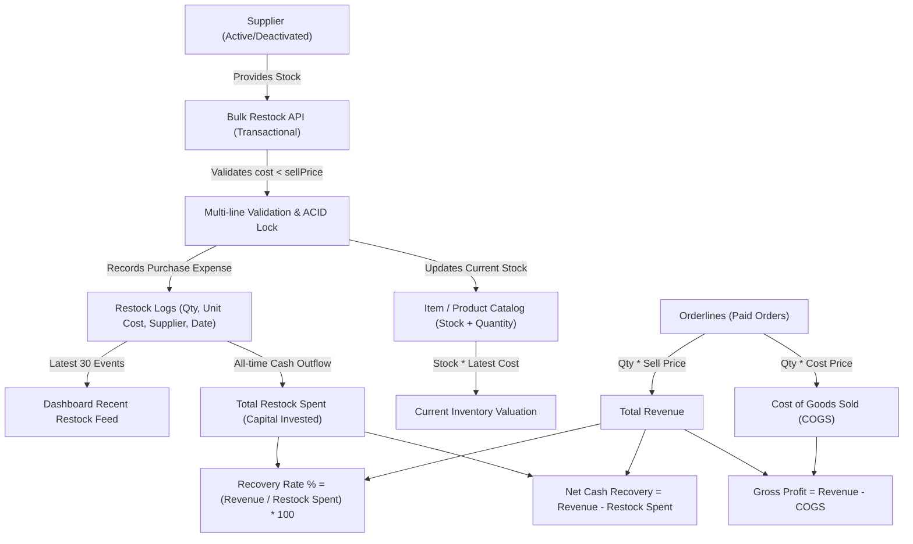
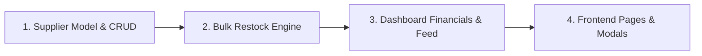

# Tunify Supplier & Restock Architecture & Implementation Specification

This document details the exact business logic, database schema, transaction flows, and dashboard telemetry discovered in [Tunify](https://github.com/YohSupremo/tunify) and [Tunify Backend](https://github.com/YohSupremo/tunify_backend), followed by a step-by-step roadmap for implementing these patterns in the **Motorcycled** MERN stack (`Node.js/Express ESM` + `MongoDB/Mongoose` + `React 19/Redux/Tailwind`).

---

## 1. Executive Summary & Core Logic in Tunify

Tunify manages inventory acquisition through a tight loop between **Suppliers**, **Restock Logs**, **Item Stock**, and **Financial Telemetry**:



---

## 2. Tunify Component Analysis

### A. Supplier Management (`controllers/supplier.js`)

1. **Schema & Fields**:
   - `id`: Auto-increment integer PK.
   - `name`: Unique, trimmed, required string.
   - `contact_name`, `email`, `phone`, `address_line`: Nullable contact details.
   - `deleted_at`: Soft-delete timestamp (`null` for active, timestamp for deactivated).
2. **Filtering by Status**:
   - Accepts query parameter `?status=active|deactivated|all`.
   - `active`: `WHERE deleted_at IS NULL`
   - `deactivated`: `WHERE deleted_at IS NOT NULL`
   - `all`: All records regardless of status.
3. **Aggregate Counts on List**:
   - For every supplier returned, computes `restock_count`:
     ```javascript
     const restockCount = await db.RestockLog.count({ where: { supplier_id: s.id } });
     ```
4. **Strict Audit Preservation Guard (Deactivation Rule)**:
   - A supplier **cannot** be deactivated if they have ever supplied goods:
     ```javascript
     const restockCount = await db.RestockLog.count({ where: { supplier_id: id } });
     if (restockCount > 0) {
       return res.status(400).json({
         error: `Cannot deactivate supplier — they have ${restockCount} restock log entry(s). Restock history must be preserved.`
       });
     }
     await supplier.update({ deleted_at: new Date() });
     ```
5. **Reactivation**:
   - Admins can restore deactivated suppliers by setting `deleted_at = null`.

---

### B. Bulk & Multi-Restocking Engine (`controllers/stock.js`)

Tunify does not use separate endpoints for single vs. multiple restocks; it uses a single transactional endpoint: `POST /api/v1/stocks/bulk-restock`.

#### Request Payload
```json
{
  "restocks": [
    {
      "itemId": 1,
      "supplierId": 3,
      "quantityToAdd": 15,
      "costPrice": 4200.00
    },
    {
      "itemId": 4,
      "supplierId": 2,
      "quantityToAdd": 5,
      "costPrice": 12500.50
    }
  ]
}
```

#### Processing Rules & Validations
1. **ACID Transaction**: Wrapped inside `await db.sequelize.transaction()`. If any item fails, the entire batch rolls back.
2. **Validation Loop**:
   - `supplierId`: Must exist and be active (`deleted_at: null`).
   - `quantityToAdd`: Must be an integer $\ge 1$.
   - `costPrice`: Must be a positive number $> 0$.
   - `itemId`: Must exist and not be soft-deleted.
   - **Critical Margin Rule**: Unit cost must be strictly less than the product's selling price:
     $$\text{costPrice} < \text{item.sell\_price}$$
     If $\text{costPrice} \ge \text{item.sell\_price}$, the restock is rejected because selling at or below cost is prevented by business logic.
3. **Line-Specific Error Feedback**:
   - Collects all failed lines in `failedLines: [{ lineIndex, itemId, reason }]`.
   - If any fail, returns `400 Bad Request` with exact line feedback for the admin UI to display.
4. **Commit Phase**:
   - Increments inventory: `item.quantity += quantityToAdd`
   - Creates audit record in `restock_logs` with `(item_id, supplier_id, quantity, cost_price)`.
   - Commits transaction.

#### Frontend Bulk Restock Modal (`admin/js/admin-stock.js`)
- Dynamic table with columns: **Item**, **Supplier**, **Quantity**, **Cost Price**, and **Remove Row**.
- Includes `+ Add Row` button to restock any number of items in one submission.
- Selecting an item auto-fills the cost input with the item's previous/recorded cost price.
- Client-side validation validates all rows before submission. Minimum of 1 row required.

---

### C. Restock Logs & History Audit (`controllers/restockLog.js`)

- Endpoint: `GET /api/v1/stocks/logs`
- Query Filters: `supplier_id`, `item_id`, `brand_id`, `category_id`, `date_from`, `date_to`.
- Each log computes:
  $$\text{total\_cost} = \text{quantity} \times \text{cost\_price}$$
- Summary metrics displayed at the top:
  - **Total Entries** ($N$)
  - **Total Units Added** ($\sum \text{quantity}$)
  - **Total Cost Value** ($\sum (\text{quantity} \times \text{cost\_price})$)

---

### D. Expense Tracking & Financial Dashboard (`controllers/dashboard.js`)

Tunify calculates expenses and profitability through two complementary lenses:

#### 1. Cash Inflow vs. Cash Outflow (Capital Investment & Net Recovery)
- **Total Restock Spent** (All-time inventory purchases):
  $$\text{totalRestockSpent} = \sum_{\text{restock\_logs}} (\text{quantity} \times \text{cost\_price})$$
- **Total Revenue**:
  $$\text{revenue} = \sum_{\text{paid orders}} (\text{quantity} \times \text{sell\_price})$$
- **Net Cash Recovery**:
  $$\text{net} = \text{revenue} - \text{totalRestockSpent}$$
- **Capital Recovery Rate**:
  $$\text{recoveryPct} = \min\left(100, \frac{\text{revenue}}{\text{totalRestockSpent}} \times 100\right)\%$$
  - Rendered as a recovery progress bar:
    - Net $\ge 0$: Green gradient with message *"In profit — ₱X earned, ₱Y invested"*.
    - Net $< 0$: Amber/Red gradient with message *"You're ₱X in the negative — ₱Y invested, ₱Z earned so far"*.

#### 2. Accrual Accounting (COGS & Gross Profit)
- **Cost of Goods Sold (COGS)**:
  $$\text{total\_cogs} = \sum_{\text{paid orders}} (\text{orderline.quantity} \times \text{orderline.cost\_price})$$
- **Gross Profit**:
  $$\text{gross\_profit} = \text{revenue} - \text{cogs}$$
- **Current Inventory Valuation**:
  $$\text{inventory\_value} = \sum_{\text{active items}} (\text{item.quantity} \times \text{latest\_cost\_price})$$

#### 3. Monthly Sales vs. Cost Chart
- Endpoint: `GET /api/v1/sales-chart`
- Groups paid orders by month to display a comparative bar/line chart of:
  - Monthly Selling Revenue
  - Monthly COGS (Expenses)

---

### E. Dashboard Recent Restocks Activity Feed (`controllers/dashboard.js`)

- Endpoint: `GET /api/v1/stock-activity`
- Query:
  ```sql
  SELECT 
    rl.created_at AS event_time,
    i.name AS item_name,
    rl.quantity,
    rl.cost_price,
    COALESCE(s.name, 'No Supplier') AS supplier_name,
    (rl.quantity * rl.cost_price) AS total_cost
  FROM restock_logs rl
  INNER JOIN item i ON rl.item_id = i.id
  LEFT JOIN supplier s ON rl.supplier_id = s.id
  ORDER BY rl.created_at DESC
  LIMIT 30;
  ```
- Dashboard Widget UI:
  - Displays list of recent restock events with:
    - Box/truck icon.
    - Product name.
    - Unit cost price (`₱4,500 / unit`).
    - Total cost (`Total: ₱45,000`).
    - Supplier name badge.
    - Relative timestamp (`timeAgo`: e.g., *"12m ago"*, *"3h ago"*, *"Yesterday"*).
    - Green quantity pill (`+10 units`).

---

## 3. Implementation Plan for Motorcycled

Motorcycled already has:
- `backend/model/InventoryTransaction.js` with fields: `product`, `productName`, `type: "restock"`, `quantityChange`, `supplierId`, `supplierName`, `unitCost`, `performedBy`, `note`.
- Single restock endpoint in `backend/controllers/inventoryController.js`.
- Admin dashboard telemetry in `backend/controllers/orderController.js`.

### Implementation Steps



### Step 1: Create Dedicated `Supplier` Model & Controller in Motorcycled Backend
- **Model** (`backend/model/Supplier.js`):
  - `name`: String, required, unique, trimmed.
  - `contactPerson`: String, trimmed.
  - `email`: String, lowercase, trimmed.
  - `phone`: String, trimmed.
  - `address`: String, trimmed.
  - `isArchived` / `deletedAt`: Date, default `null`.
- **Controller** (`backend/controllers/supplierController.js`):
  - `getSuppliers`: Accepts `?status=active|deactivated|all`. Returns each supplier with `restockCount` aggregated from `InventoryTransaction`.
  - `createSupplier`: Validates unique name.
  - `updateSupplier`: Updates contact and details.
  - `deleteSupplier` (Soft Delete): Enforces Tunify's guard: if `InventoryTransaction.countDocuments({ supplierId: id, type: 'restock' }) > 0`, reject deactivation to preserve financial audit trail!
  - `restoreSupplier`: Sets `deletedAt = null`.
- **Routes** (`backend/routes/supplierRoutes.js`): Protected by `auth` and `authorizeRoles("admin")`.

### Step 2: Implement Bulk Restocking in `backend/controllers/inventoryController.js`
- Create `bulkRestock` endpoint: `POST /api/v1/admin/inventory/bulk-restock`.
- Body: `{ restocks: [{ productId, supplierId, quantity, unitCost, note }] }`.
- Execution:
  1. Open a Mongoose session with `runInTransaction`.
  2. Validate each line:
     - Supplier exists and is active.
     - Quantity is positive integer $\ge 1$.
     - Unit cost is positive number $> 0$.
     - Product exists and `unitCost < product.price`.
  3. Return `failedLines: [{ lineIndex, productId, reason }]` if validation fails.
  4. In transaction:
     - Increment `product.stock += quantity`.
     - Update product's `costPrice` to latest `unitCost`.
     - Create `InventoryTransaction` record (`type: 'restock'`, `quantityChange: quantity`, `unitCost`, `supplierId`, `supplierName`).

### Step 3: Enhance Dashboard Financials & Stock Activity in `backend/controllers/orderController.js`
- In `getDashboardStats`:
  1. Compute **Total Restock Expenses**:
     ```javascript
     const totalRestockSpent = await InventoryTransaction.aggregate([
       { $match: { type: "restock" } },
       { $group: { _id: null, total: { $sum: { $multiply: ["$quantityChange", "$unitCost"] } } } }
     ]);
     ```
  2. Compute **Current Inventory Valuation**:
     $$\sum (\text{product.stock} \times \text{product.costPrice})$$
  3. Compute **Net Cash Recovery & Recovery Rate %**:
     ```javascript
     const netCashRecovery = totalRevenue - (totalRestockSpent[0]?.total || 0);
     const recoveryRate = totalRestockSpent[0]?.total > 0
       ? Math.min(100, (totalRevenue / totalRestockSpent[0].total) * 100)
       : 100;
     ```
  4. Add **Recent Restocks Activity Feed**:
     ```javascript
     const recentRestocks = await InventoryTransaction.find({ type: "restock" })
       .sort({ createdAt: -1 })
       .limit(20)
       .lean();
     ```
     Returning `productName`, `quantityChange`, `unitCost`, `totalCost: quantityChange * unitCost`, `supplierName`, `createdAt`.

### Step 4: Frontend Implementation in Motorcycled
1. **Admin Suppliers Page** (`frontend/src/assets/pages/admin/AdminSuppliers.jsx`):
   - Table with status tabs (Active, Deactivated, All).
   - Columns: Supplier Name, Contact Person, Email, Phone, Total Restocks, Actions.
   - Add/Edit Supplier modal.
   - Deactivate button with confirmation; shows warning if restocks exist.
2. **Bulk Restock Modal** (`frontend/src/assets/pages/admin/AdminInventory.jsx`):
   - Multi-row restock dialog with dynamic row addition/removal.
   - Auto-filling cost price from catalog.
   - Real-time client-side validation that `cost < sellingPrice`.
3. **Admin Dashboard Widgets** (`frontend/src/assets/pages/admin/AdminDashboard.jsx`):
   - Financial stat cards: Total Revenue, Total Restock Outflow, Net Recovery, Inventory Value.
   - Capital Recovery progress bar with dynamic color grading.
   - Recent Restocks Activity Feed with live timestamps and unit breakdown.
